# Mastère DevOps M2 — Sup de Vinci
## Module E54 : CI/CD Avancé & Déploiement Continu
### Bloc 5, RNCP 40165 · Activité 12b : GitOps et Stratégies de Release Avancées

---

## Composition du Binôme
- **Aimen KLAI** ([@aimenklai](https://github.com/aimenklai))
- **Moustapha ARAFAT** ([@ARAFAT-Moustaph](https://github.com/ARAFAT-Moustaph))

**Dépôt GitOps officiel :** [https://github.com/ARAFAT-Moustaph/taskflow-gitops](https://github.com/ARAFAT-Moustaph/taskflow-gitops)

---

## Table des Matières
1. [Principes d'Architecture & Boucle GitOps](#1-principes-darchitecture--boucle-gitops)
2. [Stratégie 1 : Déploiement Blue-Green & Dédoublement de Charge](#2-stratégie-1--déploiement-blue-green--dédoublement-de-charge)
3. [Stratégie 2 : Déploiement Canary Progressif & Détection Manuelle](#3-stratégie-2--déploiement-canary-progressif--détection-manuelle)
4. [Stratégie 3 : Analyse Automatisée de Robustesse (SRE & Automated Canary Analysis)](#4-stratégie-3--analyse-automatisée-de-robustesse-sre--automated-canary-analysis)
5. [Dossier d'Observabilité : Pourquoi et Comment Mesurer la Qualité ?](#5-dossier-dobservabilité--pourquoi-et-comment-mesurer-la-qualité)
6. [Étude Comparative : Blue-Green vs Canary vs Canary Automatisé](#6-étude-comparative--blue-green-vs-canary-vs-canary-automatisé)
7. [Journal Intégral des Déploiements (PR #1 à PR #17)](#7-journal-intégral-des-déploiements-pr-1-à-pr-17)
8. [Galerie Intégrale des 26 Preuves Visuelles](#8-galerie-intégrale-des-26-preuves-visuelles)
9. [Guide de Reproduction & Commandes Clés](#9-guide-de-reproduction--commandes-clés)

---

## 1. Principes d'Architecture & Boucle GitOps

Le principe fondamental appliqué tout au long de ce projet est que **Git constitue l'unique source de vérité (*Single Source of Truth*) pour l'état du cluster**. 

Toute modification en production est initiée sous la forme d'un commit tracé, soumis à revue par les pairs via une Pull Request sur GitHub protégée par un Ruleset. L'agent interne **Argo CD** surveille la branche principale et synchronise l'état réel de Kubernetes en mode Pull.

### Réponses aux questions fondamentales d'ingénierie

#### 1. Déploiement Push ou Pull ? Pourquoi le modèle Pull est supérieur ?
Notre architecture fonctionne selon le modèle **Pull (GitOps)** :
- **Modèle Push classique :** Le pipeline CI externe dispose d'accès privilégiés (`kubeconfig` administrateur) et pousse directement les manifests sur l'API Kubernetes. Cela expose des secrets critiques en dehors du cluster, transforme la CI en point unique de compromission, et ne permet pas de détecter les dérives faites en direct sur le serveur.
- **Modèle Pull (Argo CD) :** L'agent Argo CD s'exécute à l'intérieur du cluster. Il interroge périodiquement le dépôt Git et réconcilie l'état réel avec l'état déclaré. Aucun port d'administration n'est exposé vers l'extérieur. Si quelqu'un modifie manuellement le cluster, l'agent réconcilie immédiatement l'état vers la référence Git.

#### 2. Qui a corrigé quoi lors de la dérive (*Drift*) ?
Lors du test de panne où nous avons manuellement forcé le cluster à 8 pods via :
```bash
kubectl scale deployment taskflow -n taskflow --replicas=8
```
C'est **Argo CD** qui a détecté la divergence grâce à sa directive déclarée `selfHeal: true`. En comparant les 8 pods actifs avec la valeur déclarée dans Git (`replicas: 4`), Argo CD a passé les 4 pods surnuméraires en statut `Terminating` en **9 secondes**, rétablissant strictement l'état consigné dans Git.

#### 3. Pourquoi faire un `git revert` plutôt qu'une commande manuelle sur le cluster ?
Une commande impérative telle que `kubectl rollout undo` ou `kubectl set image` est immédiatement écrasée par la boucle de réconciliation d'Argo CD qui réapplique ce qui est écrit dans Git.
Faire un `git revert` présente trois bénéfices fondamentaux :
1. **Intégrité de la source de vérité :** Le cluster reste strictement conforme à la branche `main`.
2. **Auditabilité et traçabilité :** L'annulation génère un commit d'historique explicite et passe par le processus standard de Pull Request validée par le binôme.
3. **Absence de dérive (*Zero Drift*) :** Le cluster et Git ne divergent à aucun moment dans le temps.

---

## 2. Stratégie 1 : Déploiement Blue-Green & Dédoublement de Charge

### Pourquoi avoir mis en place le Blue-Green ?
Le contrôleur par défaut de Kubernetes (`Deployment`) utilise une stratégie de *Rolling Update*. Durant la transition, les anciennes et les nouvelles versions cohabitent sur le même service et se partagent le trafic des utilisateurs. Si la nouvelle version comporte une régression critique, les utilisateurs subissent des erreurs en direct pendant le déploiement.

La stratégie **Blue-Green** résout ce problème par une stricte isolation environnementale :
- **Version active (Bleu) :** Les pods en version stable (1.0.0) reçoivent 100 % du trafic via le service de production `taskflow`.
- **Version candidate (Vert) :** Les pods en nouvelle version (1.1.0) démarrent sur un service distinct et isolé, `taskflow-preview`. Les tests de validation s'effectuent sans exposer le moindre utilisateur de production.

### Pourquoi le nombre de pods a doublé (4 pods -> 8 pods) ?
Durant la phase de prévisualisation, nous avons constaté la présence simultanée de **8 pods** dans le namespace `taskflow` :
- 4 pods hébergeant la version 1.0.0 (ReplicaSet actif).
- 4 pods hébergeant la version 1.1.0 (ReplicaSet preview).

Ce doublement est mathématique : pour que la qualification soit représentative de la charge de production, l'environnement candidat doit être instancié à pleine capacité avant la bascule.

**Conséquence sur le dimensionnement des ressources :**
- Empreinte CPU requise : `8 x 50m` = **400m de CPU**.
- Empreinte mémoire requise : `8 x 64Mi` = **512 Mi de RAM**.
Le Blue-Green implique donc une surallocation temporaire de **+100 % des ressources** matérielles pendant toute la durée des tests de validation.

### Bascule (*Promotion*) et drainage gracieux
Une fois la conformité validée sur `taskflow-preview` via le script `observe.sh` (100 % de réponses HTTP 200 en version 1.1.0), la bascule est déclenchée par la commande :
```bash
kubectl argo rollouts promote taskflow -n taskflow
```
- **Mécanisme technique sous le capot :** Le contrôleur Argo Rollouts modifie instantanément le **Selector** du service de production `taskflow` pour pointer vers le label de hash du ReplicaSet vert. Le basculement réseau est immédiat (quelques millisecondes).
- **Rôle du paramètre `scaleDownDelaySeconds: 30` :** Les 4 anciens pods bleus ne sont pas détruits sur-le-champ. Un délai de 30 secondes est conservé pour permettre le drainage gracieux (*connection draining*) des requêtes HTTP en cours, évitant toute rupture brutale de session pour les clients connectés.

---

## 3. Stratégie 2 : Déploiement Canary Progressif & Détection Manuelle

### Pourquoi passer au Canary ?
Bien que le Blue-Green apporte une isolation totale, il présente deux limites majeures en production :
1. **Le coût d'infrastructure :** Doubler le nombre de pods n'est pas viable sur des architectures volumineuses (ex: passer de 200 à 400 pods génère un surcoût Cloud significatif).
2. **L'effet tout-ou-rien :** La promotion bascule l'intégralité du trafic d'un coup. Un bug latent qui ne se manifeste que sous charge réelle impacte alors 100 % des utilisateurs dès la bascule.

La stratégie **Canary** pallie ces défauts en acheminant progressivement une fraction du trafic réel vers la nouvelle version sans surallocation de ressources.

### Répartition statistique du trafic (25 % / 75 %)
Sans maillage de services (*Service Mesh* type Istio ou Linkerd), le routage du trafic repose sur la proportion de pods dans le Service Kubernetes.
Avec `replicas: 4` et une première étape `setWeight: 25` :
- 1 pod exécute la version candidate 2.0.0.
- 3 pods exécutent la version stable 1.1.0.
- Total : **4 pods maintenus**, aucune surconsommation de ressources.

L'exécution de `./scripts/observe.sh taskflow 40` a confirmé cette répartition statistique réelle :
- **27 requêtes** traitées par la version 1.1.0 (~70 %).
- **13 requêtes** traitées par la version 2.0.0 (~30 %).

### Test de défaillance applicative (v2.1.0) et coupure d'urgence (`abort`)
Pour évaluer la résilience du modèle, nous avons déployé l'image `2.1.0` (PR #11).  
L'exécution de `observe.sh` a mis en évidence des erreurs applicatives :
```text
33 version=2.0.0 http=200
 5 version=2.1.0 http=200
 2 version=aucune http=500
```
Pour couper l'incident et protéger les utilisateurs, une commande d'urgence a été exécutée par l'opérateur :
```bash
kubectl argo rollouts abort taskflow -n taskflow
```
Le contrôleur a instantanément retiré le pod canari 2.1.0 du trafic et redirigé l'ensemble des flux vers la version 2.0.0 saine (`40 version=2.0.0 http=200`).

### Pourquoi la commande `abort` seule ne suffit pas en GitOps ?
La commande `abort` isole l'incendie sur le cluster, mais dans Git, la branche `main` pointait toujours vers le commit introduisant la version 2.1.0 défaillante. Il y avait donc une **dérive (*drift*)** entre Git et le cluster.  
Pour rétablir l'intégrité de la source de vérité, il a fallu réaliser un **`git revert` sur GitHub (PR #12)** afin que la version stable 2.0.0 redevienne la référence déclarée.

---

## 4. Stratégie 3 : Analyse Automatisée de Robustesse (SRE & Automated Canary Analysis)

### Pourquoi l'automatisation de l'analyse est indispensable ?
La détection manuelle humaine a ses limites : un ingénieur ne peut pas rester rivé sur un terminal 24h/24 pour exécuter `observe.sh` et taper `abort` en urgence.  
L'approche moderne **SRE (Site Reliability Engineering)** automatise cette boucle de rétroaction : dès qu'une version canary arrive à un palier de trafic, un test de charge automatisé mesure des métriques précises. Si ces métriques dépassent les seuils tolérés, **le déploiement est avorté tout seul en quelques secondes**.

Le rapport d'incident détaillé est disponible dans : [docs/postmortem-2.1.0.md](docs/postmortem-2.1.0.md).

### Fonctionnement technique sous le capot
Le mécanisme repose sur l'interaction de 4 manifests Kubernetes ([apps/taskflow](apps/taskflow)) :

```text
[Rollout à 25%] ──> [Déclenche AnalysisRun] ──> [Crée un Job Pod k6]
                          │                              │
                          │                              ▼
                          │                     Exécute robustesse.js
                          │                     sur http://taskflow-canary
                          ▼                              │
             Évalue les métriques (Thresholds) <─────────┘
              ├── Si Succès : Poursuit vers 50%, 75%, 100%
              └── Si Échec  : Abort automatique immédiat (ScaleDown à 0)
```

1. **`service-canary.yaml` (`taskflow-canary`) :** Un Service Kubernetes distinct dont le `selector` est piloté dynamiquement par Argo Rollouts pour ne cibler **que** les pods de la nouvelle version canary. Le test k6 attaque ce service pour ne pas perturber les utilisateurs de production.
2. **`configmap-k6.yaml` (`k6-robustesse`) :** Contient le script k6 `robustesse.js`. Il génère 5 utilisateurs virtuels (VUs) pendant 30 secondes et applique deux critères de rejet stricts :
   - Taux d'échec : `http_req_failed < 0.02` (moins de 2 % d'erreurs).
   - Latence au 95e centile : `http_req_duration: p(95) < 250` (95 % des requêtes en moins de 250 ms).
3. **`analysis-template.yaml` (`AnalysisTemplate/robustesse-k6`) :** La ressource personnalisée (CRD) qui ordonne à Kubernetes de lancer un Job éphémère contenant l'image `grafana/k6:latest`, montant le ConfigMap et recevant l'argument cible `http://taskflow-canary`.
4. **`rollout.yaml` :** Intègre l'étape d'analyse au palier 25 % :
   ```yaml
   strategy:
     canary:
       canaryService: taskflow-canary
       steps:
         - setWeight: 25
         - pause: { duration: 20s }
         - analysis:
             templates:
               - templateName: robustesse-k6
             args:
               - name: cible
                 value: http://taskflow-canary
         - setWeight: 50
         - pause: { duration: 30s }
         - setWeight: 75
         - pause: { duration: 30s }
   ```

### L'Incident de la v2.1.0 et la cécité des Probes Kubernetes
Lors du déploiement de la v2.1.0 (PR #15), le test k6 s'est déclenché automatiquement et a mesuré :
* **28.81 % d'erreurs HTTP** (85 échecs sur 295 requêtes).
* **p95 de 327.1 ms** (seuil de 250 ms franchi).

**Pourquoi les sondes Kubernetes (*Probes*) n'avaient rien vu ?**
Les sondes `readinessProbe` et `livenessProbe` surveillent l'URL `/health`. Dans l'image 2.1.0, le serveur web répondait `200 OK` sur `/health` (le serveur tournait). En revanche, l'endpoint métier utilisé par les clients (`/tasks`) renvoyait des erreurs `HTTP 500`.  
Pour Kubernetes classique, le pod était sain (`ready: 1/1`). **Seule l'analyse canary avec tir de charge k6 a pu dévoiler la panne et déclencher l'abort automatique.**

### Le correctif de la v2.2.0 et la promotion à 100 %
Après avoir réaligné Git via un Revert (PR #16), la version corrective `2.2.0` a été déployée (PR #17).  
Cette fois-ci :
* L'AnalysisRun `taskflow-7ddd57d788-7-2` s'est terminée avec le statut **`✔ Successful`** (0 % d'erreur, p95 < 250 ms).
* Argo Rollouts a automatiquement promu l'application à 50 %, puis 75 %, puis **100 %**.
* Statut final : **`✔ Healthy`** en version 2.2.0.

---

## 5. Dossier d'Observabilité : Pourquoi et Comment Mesurer la Qualité ?

### Les Métriques Clés exploitées

| Métrique | Outil de mesure | Signification concrète | Seuil appliqué | Rôle dans la décision |
| :--- | :--- | :--- | :--- | :--- |
| **`http_req_failed`** | k6 (`thresholds`) | Pourcentage de requêtes HTTP ne renvoyant pas de code 200. | `< 0.02` (2 %) | Détecte les crashs applicatifs et erreurs 500. Déclencheur immédiat de rollback si violé. |
| **`p(95)` (`http_req_duration`)** | k6 (`thresholds`) | Durée maximale constatée pour 95 % des requêtes les plus rapides. | `< 250 ms` | Détecte les fuites de mémoire, contentions de base de données ou ralentissements insidieux. |
| **Codes statut HTTP** | `observe.sh` / k6 | Répartition statistique des codes 200 vs 500. | 100 % en code 200 | Garantit que le trafic utilisateur n'est pas corrompu. |
| **Statut AnalysisRun** | Argo Rollouts CRD | Évaluation formelle du Job de test par le contrôleur K8s. | `Successful` | Condition bloquante pour autoriser le passage au palier suivant. |

### Comparatif d'Observabilité : Étalon (v2.0.0) vs Incident (v2.1.0) vs Correctif (v2.2.0)

| Version testée | Requêtes envoyées | Taux d'échec mesuré | Latence p95 mesurée | Statut k6 | Décision Argo Rollouts |
| :--- | :--- | :--- | :--- | :--- | :--- |
| **v2.0.0 (Étalon)** | 708 requêtes | **`0.00 %`** (0 échec) | **`21.71 ms`** | `Seuils respectés` | Version de référence certifiée |
| **v2.1.0 (Incident)** | 295 requêtes | **`28.81 %`** (85 échecs) | **`327.10 ms`** | `Thresholds crossed` | **Abort Automatique (`Degraded`)** |
| **v2.2.0 (Correctif)** | ~700 requêtes | **`0.00 %`** (0 échec) | **`< 25 ms`** | `Successful` | **Promotion automatique à 100 %** |

---

## 6. Étude Comparative : Blue-Green vs Canary vs Canary Automatisé

| Critère d'évaluation | Blue-Green | Canary Manuel | Canary Automatisé (k6) |
| :--- | :--- | :--- | :--- |
| **Exposition au risque** | **Nulle (0 %)** : Qualification sur service prévisualisation isolé. | **Modérée (25 %)** : Des clients réels essuient les erreurs. | **Minimale** : Trafic de test k6 ciblé sur `taskflow-canary`. |
| **Surcoût en infrastructure** | **Élevé (+100 %)** : 8 pods simultanés nécessaires. | **Nul (0 %)** : 4 pods fixes partagés par palier. | **Quasi-nul** : 4 pods + 1 pod de test k6 éphémère (30s). |
| **Rôle de l'humain** | Manuel : doit observer puis taper `promote`. | Manuel : doit observer puis taper `abort`. | **Autonome** : L'humain ne surveille rien, le système décide seul. |
| **Temps de réaction en cas de bug** | Plusieurs minutes (détection humaine + commande). | Plusieurs minutes (détection humaine + commande). | **< 2 secondes** dès la fin de l'évaluation du Job. |
| **Détection des régressions métier** | Dépend des tests passés manuellement. | Aléatoire (remontée utilisateur ou logs). | **Systématique et déterministe** grâce aux seuils chiffrés. |

---

## 7. Journal Intégral des Déploiements (PR #1 à PR #17)

| PR | Heure | Version | Action réalisée | Mécanisme / Commande | Délai mesuré | Résultat technique observé |
| :--- | :--- | :--- | :--- | :--- | :--- | :--- |
| **#1** | **14:52** | `2.0.0` | Montée de version majeure | Merge PR sur `main` | ~40 s | Rolling Update automatique Argo CD. 40/40 requêtes en 2.0.0 (HTTP 200). |
| **#2** | **15:00** | `1.0.0` | Rollback suite au test de dérive | PR `git revert` mergée | ~35 s | Rétrogradation automatique par Argo CD. Rétablissement strict de la 1.0.0. |
| **#6** | **16:33** | `1.0.0` | Migration architecture Blue-Green | PR mergée sur `main` | ~30 s | Remplacement du `Deployment` par `Rollout` et création de `taskflow-preview`. |
| **#7** | **16:38** | `1.1.0` | Déploiement Blue-Green | PR mergée sur `main` | ~45 s | Dédoublement constaté : 4 pods 1.0.0 + 4 pods 1.1.0 = 8 pods. Promotion et drainage 30s. |
| **#8** | **16:57** | `1.1.0` | Migration architecture Canary | PR mergée sur `main` | ~25 s | Suppression de `service-preview.yaml` et bascule en stratégie Canary. |
| **#10** | **17:00** | `2.0.0` | Déploiement Canary progressif | PR mergée sur `main` | ~20 s | Palier 25 % : `observe.sh` relève 27 req en 1.1.0 et 13 req en 2.0.0. Promotion à 100 %. |
| **#11** | **17:11** | `2.1.0` | Injection de défaillance applicative | PR mergée sur `main` | ~15 s | Palier 25 % : `observe.sh` relève des codes `http=500` sur la version 2.1.0. |
| — | **17:13** | `2.0.0` | Coupure d'urgence manuelle | `kubectl argo rollouts abort` | Immédiat | Retrait du pod 2.1.0. Rétablissement du trafic sain à 100 % sur la 2.0.0. |
| **#12** | **17:16** | `2.0.0` | Réalignement Git suite à l'incident | PR `git revert` mergée | ~30 s | Réconciliation GitOps définitive : Git et cluster réalignés sur la version 2.0.0. |
| **#13** | **17:23** | `2.0.0` | Documentation livrable initial | PR mergée sur `main` | Immédiat | Intégration du rapport d'architecture et des preuves 1 à 15. |
| **#14** | **11:44** | `2.0.0` | Ajout de l'analyse automatique k6 | PR mergée sur `main` | ~45 s | Déploiement de l'AnalysisTemplate, ConfigMap k6 et `service-canary`. 0 Deployment. |
| **#15** | **11:57** | `2.1.0` | Déploiement 2.1.0 avec test auto | PR mergée sur `main` | ~66 s | Palier 25 % : k6 mesure 28.81 % d'erreurs. **Abort automatique par Argo Rollouts en 2s**. |
| **#16** | **12:17** | `2.0.0` | Réalignement Git (Revert incident) | PR `git revert` mergée | ~30 s | Élimination de la dérive (*drift*) entre Git et le cluster Kubernetes. |
| **#17** | **12:25** | `2.2.0` | Déploiement correctif 2.2.0 | PR mergée sur `main` | ~2m30 | Palier 25 % : AnalysisRun **`Successful`**. Promotion automatique à 50%, 75% puis **100 % Healthy**. |

---

## 8. Galerie Intégrale des 26 Preuves Visuelles

### Partie 1 : Socle GitOps & Cycle de Vie Initial
| Réf | Description de la Preuve | Aperçu Visuel |
| :--- | :--- | :--- |
| **Preuve 01** | **Règle de protection GitHub (Ruleset)** interdisant tout push direct sur `main` sans Pull Request validée. |  |
| **Preuve 02** | **Tableau de bord Argo CD** confirmant la synchronisation de l'application `taskflow` en état `Healthy / Synced`. |  |
| **Preuve 03** | **Pull Request #1 approuvée** par le binôme pour le passage en version 2.0.0. |  |
| **Preuve 04** | **Vérification du trafic v2.0.0** via `observe.sh` (40 requêtes réussies en HTTP 200). |  |
| **Preuve 05** | **Rétablissement automatique de dérive (*Self-Heal*)** par Argo CD suite au forçage manuel à 8 pods (rétabli en 9s). |  |
| **Preuve 06** | **Pull Request #2 de Rollback Git** (`git revert`) réalignant la production sur la version 1.0.0. |  |

### Partie 2 : Déploiements Blue-Green et Canary Manuels
| Réf | Description de la Preuve | Aperçu Visuel |
| :--- | :--- | :--- |
| **Preuve 07** | **PR #6 de migration Blue-Green** remplaçant le `Deployment` par un `Rollout` et créant le service preview. |  |
| **Preuve 08** | **PR #7 de passage en version 1.1.0** validée par le binôme en stratégie Blue-Green. |  |
| **Preuve 09** | **PR #8 de migration Canary** configurant les étapes de trafic progressif (25 % -> 50 % -> 75 %). |  |
| **Preuve 10** | **PR #10 de déploiement progressif v2.0.0** en stratégie Canary. |  |
| **Preuve 11** | **Répartition statistique du trafic à 25 %** : `observe.sh` relève 27 requêtes en v1.1.0 et 13 requêtes en v2.0.0. |  |
| **Preuve 12** | **Promotion Canary complète à 100 %** : 40/40 requêtes traitées par la version 2.0.0 en HTTP 200. |  |
| **Preuve 13** | **PR #11 d'injection de panne (v2.1.0)** pour éprouver la détection manuelle d'anomalies. |  |
| **Preuve 14** | **Constat visuel des erreurs HTTP 500** sur le canari via `observe.sh` lors du palier 25 %. |  |
| **Preuve 15** | **PR #12 de Revert Git** suite à l'interruption d'urgence par commande manuelle. |  |

### Partie 3 : Robustesse & Analyse Automatisée (SRE k6)
| Réf | Description de la Preuve | Aperçu Visuel |
| :--- | :--- | :--- |
| **Preuve 16** | **Étalon de référence v2.0.0** : Sortie terminal de `./scripts/charge.sh` validant p95=21.71ms et 0 % d'erreurs (708/708 req HTTP 200). | 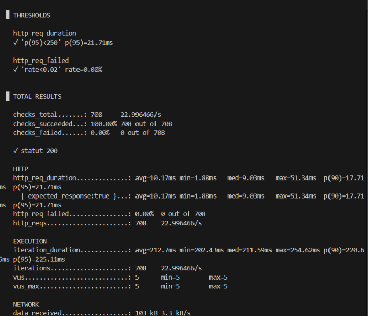 |
| **Preuve 17** | **PR #14 approuvée** intégrant l'AnalysisTemplate, ConfigMap k6 et `service-canary`. | 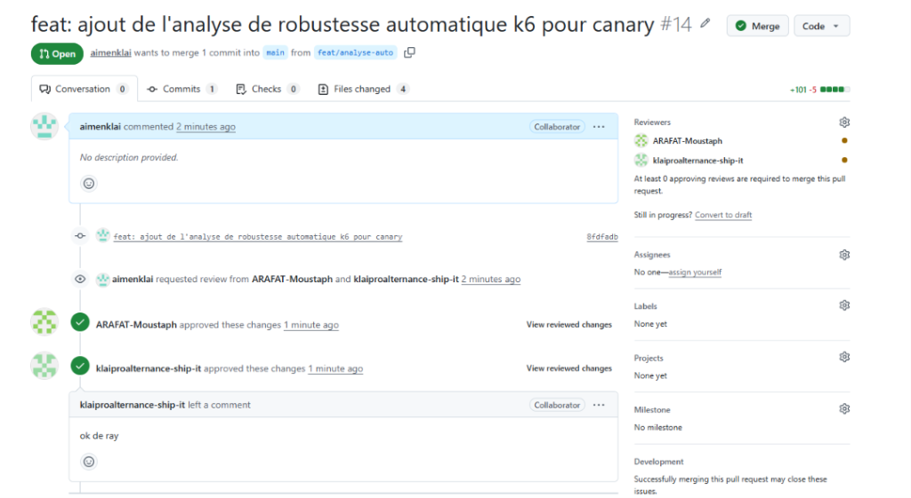 |
| **Preuve 18** | **Ressources K8s actives** : Déploiement vérifié de l'AnalysisTemplate `robustesse-k6`, ConfigMap `k6-robustesse` et des 2 Services. | 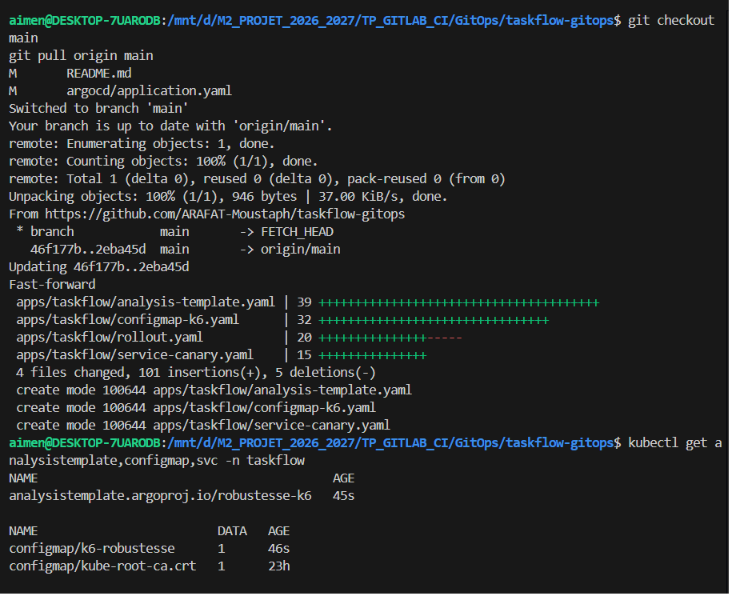 |
| **Preuve 19** | **Zéro Deployment** : Vérification stricte via `kubectl get deployment -n taskflow` prouvant que seul le Rollout pilote l'application. | 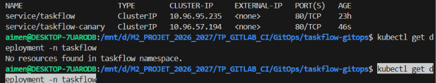 |
| **Preuve 20** | **PR #15 approuvée** déployant l'image 2.1.0 avec surveillance automatique k6. | 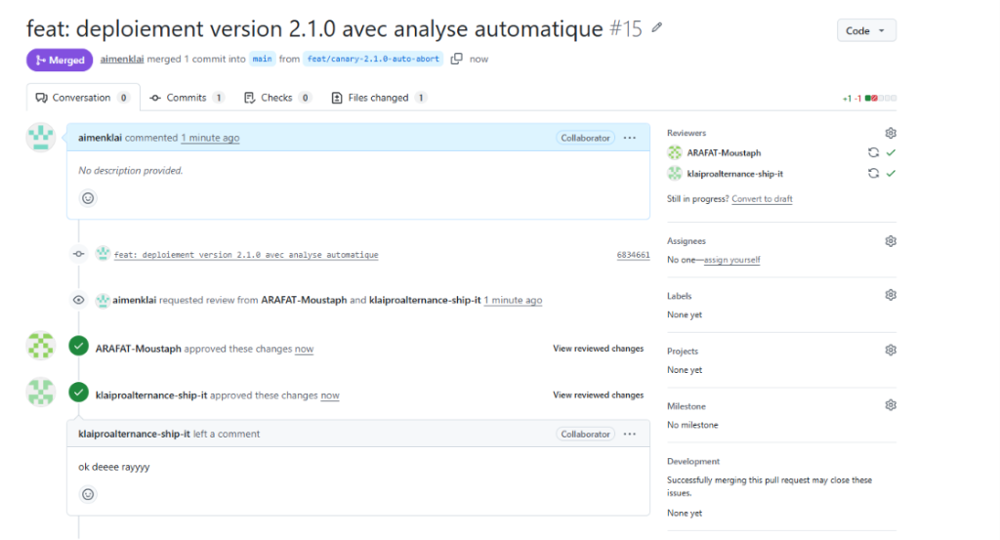 |
| **Preuve 21** | **Interception & Abort Automatique v2.1.0** : Statut Rollout basculé en `✖ Degraded` sans intervention humaine. | 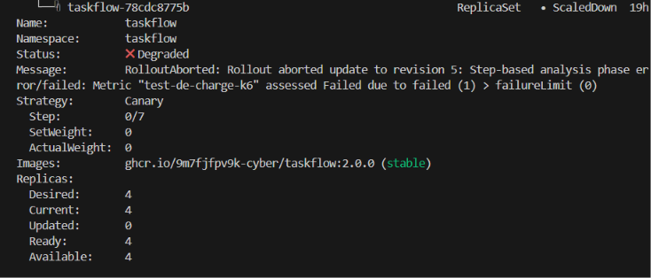 |
| **Preuve 22** | **Enquête - Preuve 1** : Constat de l'AnalysisRun `taskflow-df976ccb5-5-2` marqué `Failed` dans Kubernetes. | 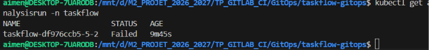 |
| **Preuve 23** | **Enquête - Preuve 2** : Logs d'exécution k6 démontrant 28.81 % d'échecs HTTP et p95=327.1ms sur la route `/tasks`. | 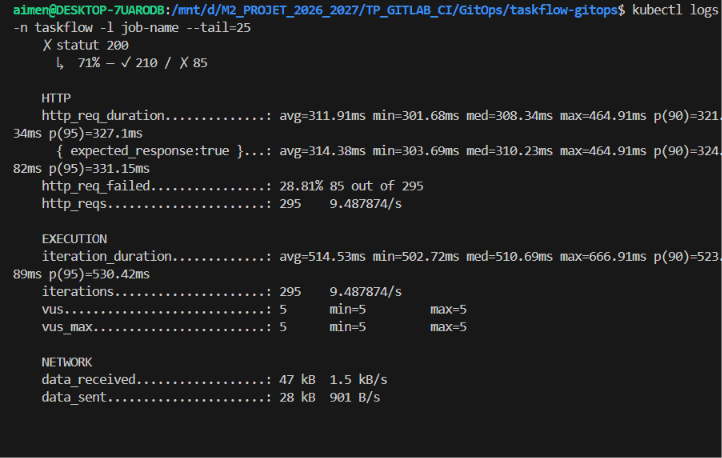 |
| **Preuve 24** | **PR #16 de Revert Git** éliminant la dérive (*drift*) entre Git et le cluster suite à l'incident 2.1.0. | 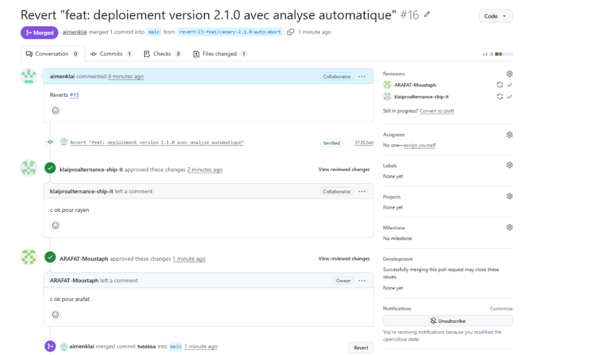 |
| **Preuve 25** | **Rollout 2.2.0 finalisé à 100 %** : Statut `✔ Healthy`, 4 pods actifs sur la version corrective 2.2.0. | 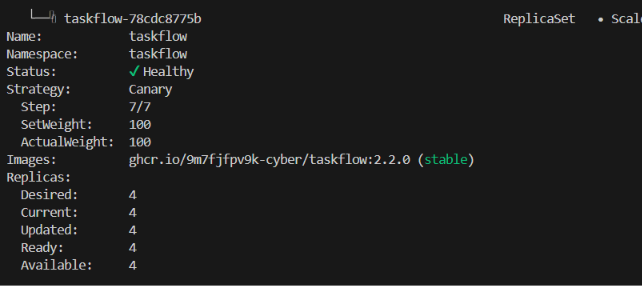 |
| **Preuve 26** | **Tableau comparatif des AnalysisRuns** : Vue conjointe de l'AnalysisRun 2.1.0 en `Failed` et 2.2.0 en `Successful`. | 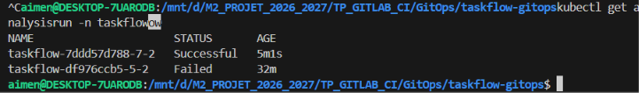 |

---

## 9. Guide de Reproduction & Commandes Clés

### 1. Surveillance et tirs de charge
```bash
# Vérifier la répartition du trafic et les codes HTTP sur 40 requêtes
./scripts/observe.sh taskflow 40

# Vérifier le service de prévisualisation (Blue-Green)
./scripts/observe.sh taskflow-preview 20

# Lancer manuellement le test d'étalon k6 sur un service donné (30s, 5 VUs)
./scripts/charge.sh http://taskflow
```

### 2. Pilotage et inspection d'Argo Rollouts
```bash
# Consulter l'état détaillé d'un Rollout
/home/aimen/.local/bin/kubectl-argo-rollouts get rollout taskflow -n taskflow

# Surveiller en direct le déroulement des étapes (Mode Watch continu)
/home/aimen/.local/bin/kubectl-argo-rollouts get rollout taskflow -n taskflow --watch

# Forcer la promotion vers l'étape suivante (si pause non temporelle)
/home/aimen/.local/bin/kubectl-argo-rollouts promote taskflow -n taskflow

# Arrêt d'urgence manuel d'un Rollout (si pas d'analyse automatique)
/home/aimen/.local/bin/kubectl-argo-rollouts abort taskflow -n taskflow
```

### 3. Inspection des analyses et des logs d'incident
```bash
# Lister l'ensemble des AnalysisRuns et leur statut (Failed / Successful)
kubectl get analysisrun -n taskflow

# Consulter le détail et les causes d'échec d'une analyse précise
kubectl describe analysisrun <nom-de-l-analysisrun> -n taskflow

# Afficher les 30 dernières lignes de logs du Job k6 ayant évalué le canary
kubectl logs -n taskflow -l job-name --tail=30

# Consulter la chronologie exacte des événements système du namespace
kubectl get events -n taskflow --sort-by='.lastTimestamp'
```
